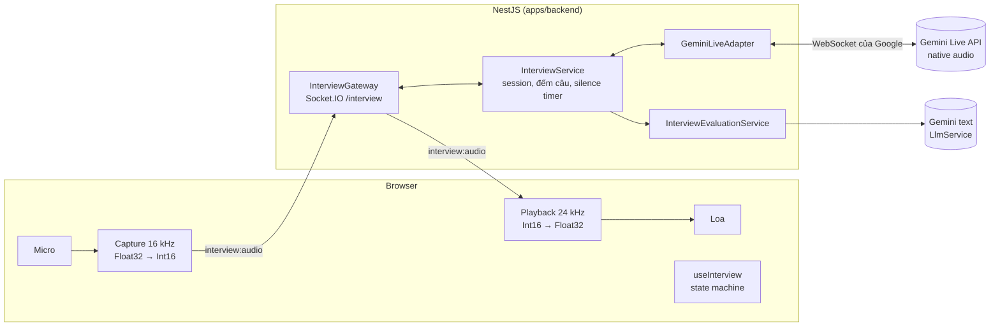
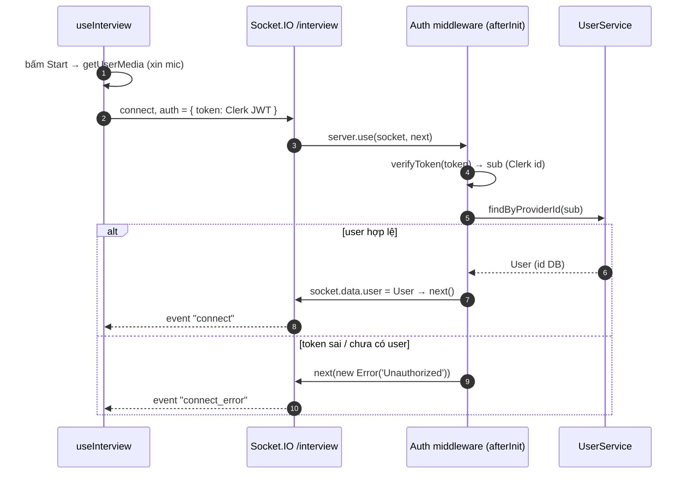
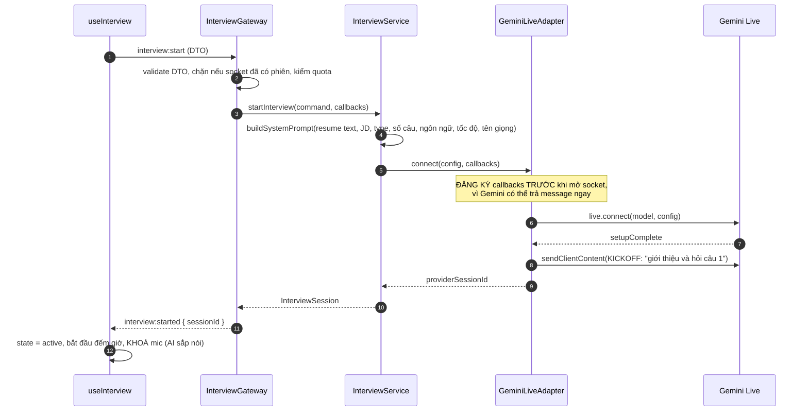
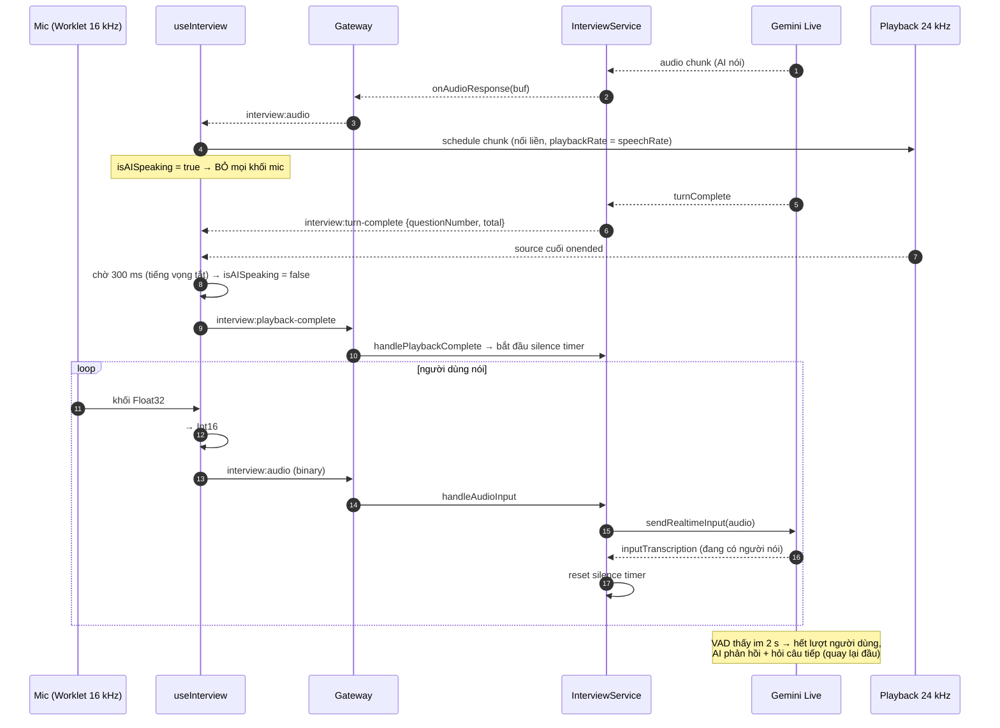
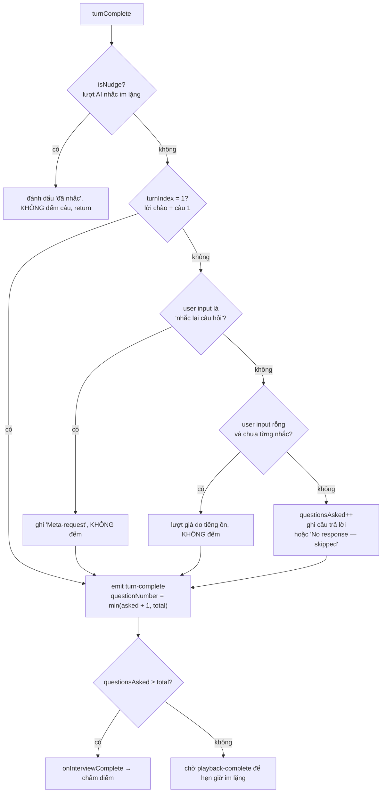
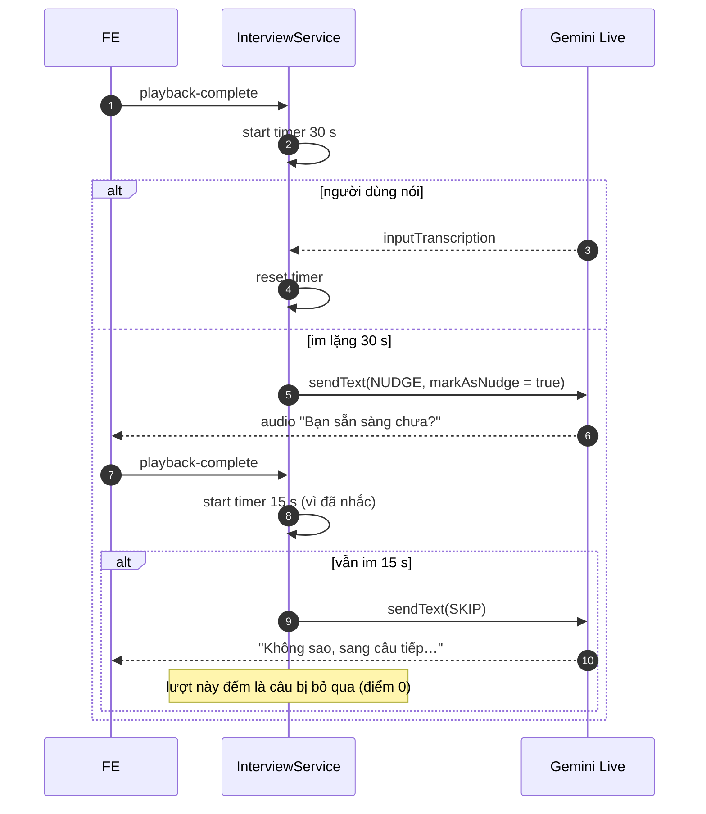
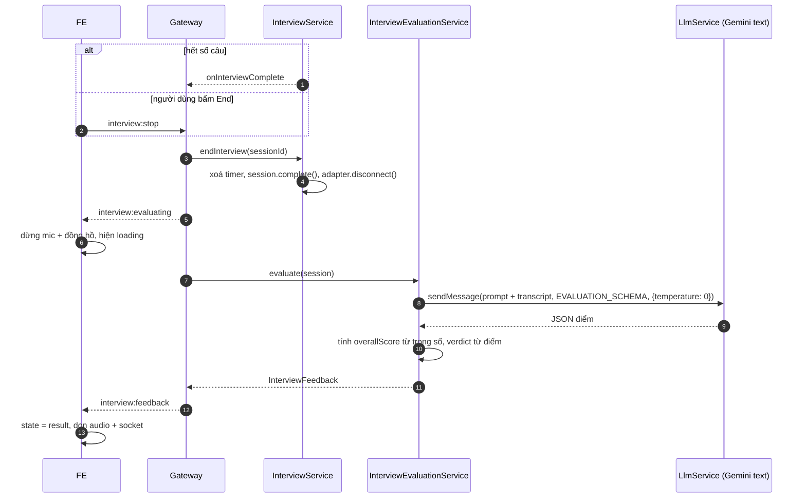
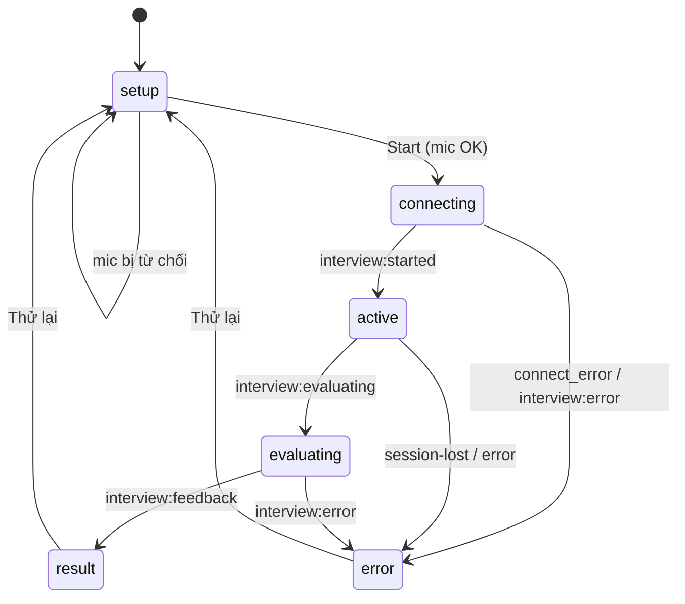

# 5. Live Interview — hướng dẫn tự implement

Tài liệu này giải thích **tính năng phỏng vấn thử bằng giọng nói** của v1
(`D:\projects\resume-builder`) từ gốc: nó làm gì, chạy thế nào, và cách
implement lại trong CraftCV theo kiến trúc hiện tại. Mục tiêu là đọc xong bạn
tự code lại được bằng tay, hiểu vì sao từng đoạn tồn tại.

Code v1 để đối chiếu:

| Phần                | File v1                                                                    |
| ------------------- | -------------------------------------------------------------------------- |
| Gateway (Socket.IO) | `apps/be/src/modules/interview/presentation/gateways/interview.gateway.ts` |
| Auth handshake      | `.../presentation/guards/ws-auth.guard.ts`                                 |
| Logic phỏng vấn     | `.../application/services/interview.service.ts`                            |
| Chấm điểm           | `.../application/services/interview-evaluation.service.ts`                 |
| Prompt + schema     | `.../application/constants/prompt.constant.ts`                             |
| Kết nối Gemini Live | `.../infrastructure/adapters/gemini-live.adapter.ts`                       |
| Hook audio FE       | `apps/fe/hooks/use-interview.ts`                                           |
| Socket client FE    | `apps/fe/services/interview.service.ts`                                    |
| UI                  | `apps/fe/components/builder-screen/interview/*`, `interview-dialog.tsx`    |

---

## 1. Tính năng làm gì

1. Ứng viên mở "Mock interview", dán Job Description (JD), chọn loại phỏng vấn
   (Technical / Behavioral / Mixed), số câu hỏi (1–10), giọng, ngôn ngữ, tốc độ nói.
2. AI **nói bằng giọng** như người phỏng vấn: chào, hỏi từng câu dựa trên CV + JD.
3. Ứng viên **trả lời bằng micro**. AI nghe, phản hồi ngắn, hỏi câu tiếp.
4. Im lặng lâu → AI nhắc nhẹ; vẫn im → bỏ qua câu đó.
5. Hết số câu (hoặc bấm Stop) → server chấm transcript → trả về điểm tổng,
   verdict (PASS / BORDERLINE / FAIL), điểm 5 tiêu chí, nhận xét từng câu,
   điểm mạnh và điểm cần cải thiện.

### Vì sao phải dùng WebSocket, không dùng REST

REST là "hỏi một lần, trả lời một lần". Ở đây audio chạy **liên tục cả hai chiều**:
mic gửi lên ~4 lần/giây trong khi AI đồng thời trả audio về. Cần một kết nối mở
suốt buổi → WebSocket (dùng Socket.IO cho tiện: có event name, tự reconnect, auth
trong handshake).

### Ba tầng



Browser **không** nói chuyện trực tiếp với Gemini: API key nằm ở server, và server
cần đứng giữa để đếm câu hỏi, ghi transcript, hẹn giờ im lặng, chấm điểm.

---

## 2. Kiến thức nền cần nắm trước khi code

### 2.1 Audio số: PCM, sample rate, Int16

- **PCM** = âm thanh dạng dãy số biên độ, không nén.
- **Sample rate** = số mẫu mỗi giây. Gemini Live yêu cầu **input 16 000 Hz mono**,
  và **trả về 24 000 Hz**. Hai tần số khác nhau → FE cần **hai `AudioContext`**.
- Web Audio làm việc với `Float32` trong khoảng `[-1, 1]`. Gemini nhận/trả
  **Int16** (`-32768..32767`). Phải đổi qua lại:

```ts
// Float32 → Int16 (gửi lên)
const s = Math.max(-1, Math.min(1, sample));
int16[i] = s < 0 ? s * 0x8000 : s * 0x7fff;

// Int16 → Float32 (nhận về)
float32[i] = int16[i] / 32768;
```

- Một mẫu Int16 = 2 byte. Chunk nhận về có số byte lẻ thì bỏ byte cuối trước khi
  tạo `Int16Array` (v1: `bytes.length & ~1`), không thì lỗi alignment.

### 2.2 Web Audio API

| Khái niệm                      | Dùng để                                                                                                                             |
| ------------------------------ | ----------------------------------------------------------------------------------------------------------------------------------- |
| `getUserMedia({ audio })`      | Xin quyền micro, lấy `MediaStream`. Bật `echoCancellation`, `noiseSuppression`, `autoGainControl`.                                  |
| `AudioContext({ sampleRate })` | "Bàn trộn" âm thanh. Capture tạo ở 16 kHz, playback ở 24 kHz.                                                                       |
| `MediaStreamAudioSourceNode`   | Đưa stream micro vào AudioContext.                                                                                                  |
| `AudioWorkletNode`             | Lấy từng khối mẫu từ mic để gửi đi. **Dùng cái này**, v1 dùng `ScriptProcessorNode` đã deprecated (chạy trên main thread, dễ giật). |
| `AudioBufferSourceNode`        | Phát một đoạn audio. Mỗi chunk AI trả về = một source.                                                                              |
| `AnalyserNode`                 | Lấy phổ tần số để vẽ waveform.                                                                                                      |

**Autoplay policy:** trình duyệt chỉ cho `AudioContext` chạy sau một thao tác của
người dùng. Tạo context **trong handler bấm nút Start**, và gọi
`ctx.resume()` nếu `ctx.state === 'suspended'`.

### 2.3 Socket.IO

- **Namespace** `/interview`: một "kênh" riêng trên cùng server.
- **Event**: `socket.emit('ten-event', payload)` / `socket.on('ten-event', cb)`.
- **Handshake auth**: client gửi `auth: { token }` lúc kết nối; server kiểm tra
  một lần trong middleware, gắn `userId` vào `socket.data`.
- Socket.IO gửi được **binary** (`ArrayBuffer`/`Buffer`) trực tiếp, không cần base64.

### 2.4 Gemini Live API (`@google/genai` → `ai.live.connect`)

Một WebSocket hai chiều giữa server bạn và Google. Các khái niệm:

| Khái niệm                                                | Ý nghĩa                                                                                                                             |
| -------------------------------------------------------- | ----------------------------------------------------------------------------------------------------------------------------------- |
| `setupComplete`                                          | Message đầu tiên sau khi kết nối xong. **Chỉ gửi gì sau message này.**                                                              |
| `sendRealtimeInput({ audio })`                           | Stream audio mic (`audio/pcm;rate=16000`, base64).                                                                                  |
| `sendClientContent({ turns })`                           | Gửi **text** vào hội thoại (kickoff, nhắc im lặng).                                                                                 |
| `serverContent.modelTurn.parts[].inlineData`             | Audio AI trả về (PCM 24 kHz, base64).                                                                                               |
| `outputAudioTranscription`                               | Gemini chép lời **AI nói** thành text → transcript.                                                                                 |
| `inputAudioTranscription`                                | Gemini chép lời **ứng viên nói** thành text → transcript + biết người dùng đang nói.                                                |
| **VAD** (Voice Activity Detection)                       | Gemini tự đoán khi nào người dùng nói xong. Chỉnh `silenceDurationMs: 2000` + `END_SENSITIVITY_LOW` để không cắt lời khi đang nghĩ. |
| `turnComplete`                                           | AI nói xong một lượt. Đây là "nhịp" để đếm câu hỏi.                                                                                 |
| `interrupted`                                            | Người dùng nói chen khi AI đang nói → AI dừng.                                                                                      |
| `speechConfig.voiceConfig.prebuiltVoiceConfig.voiceName` | Chọn giọng (Kore, Puck, Zephyr, …).                                                                                                 |

Model đặt trong env `GEMINI_LIVE_MODEL` (CraftCV đã có biến này).

---

## 3. Socket events (hợp đồng FE ↔ BE)

| Chiều | Event                         | Payload                              | Khi nào                                |
| ----- | ----------------------------- | ------------------------------------ | -------------------------------------- |
| C → S | `interview:start`             | `StartInterviewDto`                  | Ngay sau `connect`                     |
| C → S | `interview:audio`             | `ArrayBuffer` (Int16 PCM 16 kHz)     | Liên tục khi đến lượt người dùng       |
| C → S | `interview:playback-complete` | —                                    | FE phát xong audio AI (+300 ms)        |
| C → S | `interview:stop`              | —                                    | Bấm "End interview"                    |
| S → C | `interview:started`           | `{ sessionId }`                      | Đã mở phiên Gemini                     |
| S → C | `interview:audio`             | `ArrayBuffer` (Int16 PCM 24 kHz)     | Mỗi chunk giọng AI                     |
| S → C | `interview:turn-complete`     | `{ questionNumber, totalQuestions }` | AI xong một lượt                       |
| S → C | `interview:interrupted`       | —                                    | AI bị ngắt lời                         |
| S → C | `interview:evaluating`        | —                                    | Bắt đầu chấm                           |
| S → C | `interview:feedback`          | `InterviewFeedback`                  | Chấm xong                              |
| S → C | `interview:session-lost`      | `{ message }`                        | Mất kết nối Gemini, reconnect thất bại |
| S → C | `interview:error`             | `{ message }`                        | Lỗi start / chấm / quota               |

`StartInterviewDto`: `jobDescription` (≤ 20 000 ký tự), `questionCount` (1–10),
`interviewType` (`TECHNICAL | BEHAVIORAL | ALL`), `voiceName?`, `language?`,
`speechRate?` (0.5–2.0), và (đề xuất cho CraftCV) `resume` = resume đang mở trong
editor.

---

## 4. Sequence diagrams

### 4.1 Kết nối + xác thực



Auth đặt trong **middleware của server** (`afterInit` → `server.use`) chứ không
trong handler, để chắc chắn `socket.data.user` có trước mọi `@SubscribeMessage`.

> **Bug của v1 cần tránh:** v1 lấy `sub` (Clerk id) rồi gọi
> `resumeService.findByUserId(sub)`, nhưng resume lưu theo **id trong DB**. Phải
> đổi `sub` → `User` qua `UserService.findByProviderId` trước (giống
> `UserByClerkIdPipe` mà `@CurrentDbUser()` dùng).

### 4.2 Bắt đầu phỏng vấn



Gemini Live **không tự nói trước**. Phải gửi một message text "kickoff" sau
`setupComplete` thì AI mới chào và hỏi câu đầu.

### 4.3 Vòng audio và luân phiên lượt nói



**Half-duplex gating:** đường truyền thật ra là full-duplex, nhưng FE **không gửi
mic khi AI đang nói**. Nếu không, loa phát ra → mic thu lại → Gemini tưởng người
dùng ngắt lời → AI tự dừng. Ba lớp chống tiếng vọng: `echoCancellation`, chặn mic
khi `isAISpeaking`, và chờ thêm 300 ms sau khi phát xong.

**Phát audio liền mạch (gapless):** chunk về rời rạc; nếu phát ngay khi nhận sẽ bị
rè/chồng tiếng. Giữ `nextPlayTime` và xếp lịch từng chunk nối đuôi:

```ts
const start = Math.max(ctx.currentTime, nextPlayTime);
source.playbackRate.value = rate;
source.start(start);
nextPlayTime = start + buffer.duration / rate;
```

### 4.4 Đếm câu hỏi ở mỗi `turnComplete`

Đây là phần logic khó nhất của `InterviewService`. Mỗi `turnComplete` mang
`turnIndex`, transcript AI, transcript người dùng, và cờ `isNudge`.



- Lượt 1 = chào + câu 1, chưa có câu nào được trả lời.
- Lượt N > 1 = người dùng vừa trả lời câu N-1.
- "Meta-request" phát hiện bằng regex Anh/Việt (`repeat`, `say again`,
  `nhắc lại`, `nói lại`, `không nghe rõ`…) và chỉ khi câu ngắn (< 150 ký tự).

### 4.5 Hẹn giờ im lặng (2 tầng)



Timer bắt đầu khi **FE phát xong**, không phải khi server gửi xong audio: server
gửi nhanh hơn tốc độ phát nhiều, đếm từ lúc gửi thì người dùng chưa nghe hết câu
hỏi đã bị tính giờ.

### 4.6 Ngắt lời và mất kết nối Gemini

- `serverContent.interrupted` → xoá transcript lượt hiện tại, báo FE
  `interview:interrupted`; FE dừng coi như AI đã nói xong (`nextPlayTime = 0`).
- Gemini đóng bất ngờ (`onclose` mà không phải do mình đóng) → adapter **reconnect**
  tối đa 2 lần (chờ 2 s, 4 s). Kết nối lại xong, sau `setupComplete` gửi message
  "phiên vừa bị gián đoạn, ứng viên đã trả lời N câu, hãy hỏi câu N+1, đừng chào
  lại". Hết lượt thử → `onDisconnected` → FE nhận `interview:session-lost`.
- Dùng một `Set` `closingIntentionally` để phân biệt "mình chủ động đóng" và "bị rớt".

### 4.7 Kết thúc và chấm điểm



### 4.8 Đóng tab / rớt mạng phía người dùng

`handleDisconnect(socket)` → nếu socket có phiên → `cancelInterview`: xoá timer,
`session.cancel()`, đóng Gemini, xoá khỏi map. **Không chấm điểm.**

---

## 5. State machine

### FE (`useInterview`)



### BE (`InterviewSession.status`)

`IN_PROGRESS` → `COMPLETED` (hết câu / Stop, có chấm) hoặc `CANCELLED`
(ngắt kết nối, không chấm).

---

## 6. Cấu trúc thư mục trong CraftCV

### Backend (`apps/backend/src/modules/interview/`)

```
interview.module.ts
domain/
  interview-session.domain.ts      # session + ConversationTurn, đếm câu, complete/cancel
  interview-feedback.domain.ts
  index.ts
application/
  constants/interview.constant.ts  # system prompt, kickoff, nudge/skip, pace, timeout
  constants/interview-evaluation.constant.ts  # EVALUATION_CRITERIA (trọng số), prompt, schema
  interfaces/live-interview-provider.interface.ts  # port + token
  services/interview.service.ts
  services/interview-evaluation.service.ts
  index.ts (mỗi folder một barrel)
infrastructure/
  adapters/gemini-live.adapter.ts
presentation/
  gateways/interview.gateway.ts
  dtos/start-interview.dto.ts
```

`InterviewModule` import `LlmModule`, `UserModule`, `ResumeModule`; đăng ký vào
`AppModule`. Bind port: `{ provide: LIVE_INTERVIEW_PROVIDER_TOKEN, useClass: GeminiLiveAdapter }`
(giống cách `MailModule` bind `ResendAdapter`).

### Frontend (`apps/client/`)

```
public/worklets/pcm-capture.worklet.js   # AudioWorkletProcessor gửi khối mẫu về main thread
services/interview-socket.service.ts     # bọc socket.io-client: emit/on có type
hooks/use-interview.ts                   # state machine + capture + playback + cleanup
types/interview.type.ts
constants/interview.constant.ts          # loại, số câu, giọng, ngôn ngữ, tốc độ, AUDIO_CONFIG
components/builder-screens/interview/
  interview-sheet.tsx                    # khung Sheet, đổi màn theo state
  interview-setup.tsx                    # form
  interview-active.tsx                   # waveform, tiến độ, đồng hồ, mute, End
  interview-result.tsx                   # điểm, tiêu chí, từng câu, mạnh/yếu
```

---

## 7. Implement từng bước

Làm theo thứ tự; mỗi bước có cách kiểm tra riêng trước khi sang bước sau.

### B1. Domain + DTO (BE)

- `InterviewSession`: `id, userId, socketId, jobDescription, resumeText,
interviewType, totalQuestions, questionsAsked, status, conversationHistory,
providerSessionId, startedAt`; getter `shouldEndInterview = questionsAsked >= totalQuestions`;
  method `incrementQuestionCount`, `addTurn`, `complete`, `cancel`.
- `ConversationTurn`: `role ('interviewer' | 'candidate'), content, timestamp, wasNudged?, wasSkipped?`.
- `StartInterviewDto` với class-validator (giới hạn như mục 3).

**Xong khi:** unit test `InterviewSession` (đếm câu, `shouldEndInterview`).

### B2. Port + `GeminiLiveAdapter`

Port (`live-interview-provider.interface.ts`):

```ts
export interface LiveSessionCallbacks {
  onAudio(chunk: Buffer): void;
  onTurnComplete(turn: TurnCompleteData): void; // { turnIndex, aiText?, userText?, isNudge }
  onInterrupted(): void;
  onUserSpeech(): void;
  onDisconnected(reason?: string): void;
}
export interface LiveInterviewProvider {
  connect(
    config: LiveInterviewConfig,
    callbacks: LiveSessionCallbacks,
  ): Promise<string>;
  sendAudio(sessionId: string, pcm16k: Buffer): void;
  sendText(sessionId: string, text: string, markAsNudge?: boolean): void;
  disconnect(sessionId: string): Promise<void>;
}
```

(v1 có thêm `onAudioResponse/onTurnComplete/onInterrupted` dạng setter; không cần
vì callbacks đã truyền khi `connect`.)

Adapter giữ `Map<sessionId, Entry>`; `Entry` lưu: session của SDK, callbacks,
`turnCount`, `setupCompleted`, `pendingNudge`, 3 buffer transcript
(`modelText`, `outputTranscript`, `inputTranscript`), `connectConfig`,
`reconnectAttempts`, `reconnecting`.

`connect` dựng config:

```ts
{
  responseModalities: [Modality.AUDIO],
  systemInstruction,
  outputAudioTranscription: {},
  inputAudioTranscription: {},
  realtimeInputConfig: {
    automaticActivityDetection: {
      endOfSpeechSensitivity: EndSensitivity.END_SENSITIVITY_LOW,
      silenceDurationMs: 2000,
    },
  },
  speechConfig: { voiceConfig: { prebuiltVoiceConfig: { voiceName } } },
}
```

`handleMessage(msg)` theo thứ tự:

1. Không có `serverContent` mà có `setupComplete` lần đầu → gửi **kickoff**
   (hoặc message "resume" nếu là reconnect, `turnCount > 0`).
2. `interrupted` → xoá 3 buffer, `onInterrupted()`.
3. Cộng dồn `outputTranscription.text`, `inputTranscription.text` (và gọi
   `onUserSpeech()`), `modelTurn.parts[].text`; với `inlineData.data` → `onAudio(Buffer)`.
4. `turnComplete` → `turnCount++`, gọi `onTurnComplete({...})` với
   `isNudge = pendingNudge`, rồi reset buffer và `pendingNudge`.

`sendText(..., markAsNudge)` đặt `pendingNudge = markAsNudge` rồi `sendClientContent`.
Reconnect như mục 4.6.

**Xong khi:** một script nhỏ (`ts-node`) gọi `connect` với system prompt đơn giản,
ghi audio trả về ra file `.pcm`, mở bằng Audacity (Import Raw: signed 16-bit,
24000 Hz, mono) nghe được lời chào.

### B3. `InterviewService`

Trạng thái trong RAM: `sessions: Map<id, InterviewSession>`,
`silenceTimers: Map<id, Timeout>`, `nudged: Set<id>`.

- `startInterview(command, callbacks)`: dựng system prompt (thay placeholder bằng
  hàm, không `.replace(str, str)`, để chuỗi `$&` trong CV/JD không bị hiểu nhầm;
  CraftCV đã làm vậy ở `resume-email.service.ts`), sanitize CV/JD bằng
  `PromptSanitizer.sanitize`, gọi `provider.connect` với callbacks bọc lại theo
  mục 4.4, lưu session.
- `handleAudioInput`, `handlePlaybackComplete` (start timer),
  `endInterview` (trả session đã complete), `cancelInterview`.
- Silence timer theo mục 4.5 (`SILENCE_TIMEOUT_MS = 30_000`,
  `SILENCE_AFTER_NUDGE_TIMEOUT_MS = 15_000`).
- `isMetaRequest(text)` (regex Anh/Việt).

**Xong khi:** unit test với provider giả (mock `LiveInterviewProvider`) và
`jest.useFakeTimers()`:

- lượt 1 không đếm; lượt có user text đếm 1; meta-request và lượt rỗng không đếm;
- đủ `total` câu thì gọi `onInterviewComplete`;
- `playback-complete` + 30 s → `sendText(NUDGE, true)`; tiếp 15 s → `sendText(SKIP)`;
- `onUserSpeech` reset timer.

### B4. `InterviewGateway`

```ts
@WebSocketGateway({ namespace: '/interview', cors: { origin: FRONTEND_ORIGIN, credentials: true } })
export class InterviewGateway implements OnGatewayInit, OnGatewayDisconnect { ... }
```

- `afterInit(server)`: `server.use` → lấy `socket.handshake.auth.token` →
  `verifyToken` (`@clerk/backend`, `CLERK_SECRET_KEY`) → `userService.findByProviderId(sub)`
  → `socket.data.user = user`; lỗi thì `next(new Error(...))`.
- Map `socketId → sessionId`; một socket chỉ một phiên.
- `interview:start`: validate (`@UsePipes(new ValidationPipe(...))`), kiểm quota
  (B11), lấy resume (từ payload editor, hoặc `resumeService.findByUserId(user.id)`),
  `resumeToText(resume)` (có sẵn trong `resume-matching.service.ts`), gọi
  `startInterview` với callbacks emit ra socket.
- `interview:audio`: `data` là `Buffer` (binary) → `handleAudioInput`.
- `interview:playback-complete`, `interview:stop`, `handleDisconnect` → cancel.
- Lỗi trong handler: emit `interview:error` với message thân thiện, log một lần.
  (`GlobalExceptionFilter` là của HTTP, không bắt lỗi WS.)
- `ClerkAuthGuard` toàn cục đã `return true` cho context `ws`, không cần sửa.
- CORS: CraftCV đặt CORS HTTP trong `main.ts`; gateway cần `cors` riêng, lấy
  `FRONTEND_ORIGIN` từ `process.env` vì decorator chạy trước DI.

**Xong khi:** test bằng một client Node nhỏ (`socket.io-client`) với token thật:
connect được, token sai bị từ chối, `interview:start` nhận `interview:started`
và `interview:audio`.

### B5. Chấm điểm (`InterviewEvaluationService`)

- Định nghĩa `EVALUATION_CRITERIA` có trọng số như `MATCH_CRITERIA`:
  `technicalKnowledge 25, communicationSkills 20, problemSolving 20,
relevanceToRole 15, interviewConduct 20`.
- Transcript: mỗi turn một dòng `Interviewer: …` / `Candidate: … [Nudged, Skipped]`.
- Gọi `llmService.sendMessage(prompt, EVALUATION_SCHEMA, { temperature: 0 })`.
- **Tính `overallScore` ở server** từ điểm tiêu chí × trọng số (v1 để model tự
  tính, không ổn định); verdict: ≥ 70 PASS, 50–69 BORDERLINE, < 50 FAIL;
  luật "quá nửa số câu 0 điểm thì tổng ≤ 20".
- Clamp mọi điểm về 0–100, lọc mảng rỗng (giống `normalize` trong
  `resume-matching.service.ts`).

**Xong khi:** unit test với transcript mẫu + LLM giả: điểm tổng đúng công thức,
verdict đúng ngưỡng.

### B6. Socket client (FE)

- Cài `socket.io-client` cho `@repo/client`; thêm `NEXT_PUBLIC_WS_URL` vào
  `configs/env.config.ts` (đọc qua `Env`, không dùng `process.env` trực tiếp).
- `io(`${Env.NEXT_PUBLIC_WS_URL}/interview`, { auth: async (cb) => cb({ token: await session.getToken() }), transports: ['websocket'] })`.
- Bọc emit/on có type (`startInterview`, `sendAudio(ArrayBuffer)`,
  `sendPlaybackComplete`, `stop`, `onStarted`…); `disconnect()` gỡ hết listener.

### B7. Thu âm (AudioWorklet)

`public/worklets/pcm-capture.worklet.js`:

```js
class PcmCapture extends AudioWorkletProcessor {
  process(inputs) {
    const ch = inputs[0][0];
    if (ch) this.port.postMessage(ch.slice(0)); // Float32Array 128 mẫu
    return true;
  }
}
registerProcessor('pcm-capture', PcmCapture);
```

Main thread: `ctx = new AudioContext({ sampleRate: 16000 })` →
`await ctx.audioWorklet.addModule('/worklets/pcm-capture.worklet.js')` →
`source → worklet`. Worklet gửi khối 128 mẫu; **gom đến ~4096 mẫu** (~250 ms) rồi
mới đổi Int16 và `sendAudio(int16.buffer)`, tránh bắn hàng trăm message/giây.
Bỏ khối khi `muted` hoặc `isAISpeaking` (đọc từ `ref`, không từ state, vì callback
không render lại).

### B8. Phát audio

- `playCtx = new AudioContext({ sampleRate: 24000 })`, `analyser → destination`.
- Mỗi chunk: Int16 → Float32 → `createBuffer(1, n, 24000)` → `source` →
  `analyser`; xếp lịch như mục 4.3; `activeSources++`.
- `onended`: `activeSources--`; về 0 thì `setTimeout(300)` → `isAISpeaking = false`
  → `sendPlaybackComplete()`.
- `interview:interrupted`: `nextPlayTime = 0`, `activeSources = 0`, mở mic.

### B9. Hook `useInterview`

- State: `state`, `progress {current,total}`, `feedback`, `error`,
  `isAISpeaking`, `isMuted`, `elapsed`, `micAnalyser`, `playAnalyser`.
- Ref cho mọi thứ dùng trong callback audio (`isMutedRef`, `isAISpeakingRef`,
  `speechRateRef`, contexts, stream, socket).
- `start(config)`: xin mic → tạo context → connect socket → khi `connect` emit
  `interview:start` → gắn listener (`started`, `audio`, `turn-complete`,
  `interrupted`, `evaluating`, `feedback`, `error`, `session-lost`,
  `connect_error`).
- `stop()` chỉ emit `interview:stop`; server sẽ gửi `evaluating` rồi `feedback`.
- `cleanup()`: dừng track mic, đóng 2 AudioContext, ngắt socket, xoá interval;
  gọi khi unmount, khi `result`/`error`, và `beforeunload`.

### B10. UI (dùng `@repo/ui`)

- Mở từ builder: nút "Mock interview" trong `resume-control.tsx`, và nút
  **"Practice interview"** trong kết quả Job Match (truyền sẵn JD).
- Dùng `Sheet` như Job Match; màn đổi theo `state`.
- **Setup:** JD (`Textarea`), loại (`ToggleGroup`), số câu (`Slider`), ngôn ngữ và
  giọng (`Select`), tốc độ (`Slider`), ghi chú "cần micro + tai nghe để tránh vọng".
- **Active:** waveform (canvas + `requestAnimationFrame` đọc
  `getByteFrequencyData` từ analyser mic khi tới lượt người dùng, analyser
  playback khi AI nói), "Câu 2/5", đồng hồ, trạng thái "AI đang nói / Mời bạn trả
  lời", nút Mute, nút End (`AlertDialog` xác nhận).
- **Evaluating:** loading.
- **Result:** điểm tổng + verdict (dùng lại `ScoreRing`/`matchBand` của Job Match
  nếu hợp), 5 tiêu chí có trọng số, `Accordion` từng câu (câu hỏi, điểm, nhận
  xét, gợi ý), điểm mạnh / cần cải thiện, nút "Phỏng vấn lại".

### B11. Giới hạn chi phí (mới so với v1)

Gemini Live tính tiền theo thời lượng audio. Thêm:

- `INTERVIEW_DAILY_LIMIT_PER_USER` (env, Joi) + bảng `interview_sessions`
  (cũng dùng để xem lịch sử): đếm phiên 24 h như `sent_applications`.
- Thời lượng tối đa mỗi phiên (vd. 20 phút): timer trong `InterviewService`,
  hết giờ → `onInterviewComplete`.
- Kiểm `quota` **trước** khi mở Gemini.

---

## 8. Có sẵn trong CraftCV, dùng lại

| Cần                      | Đã có                                                                                                  |
| ------------------------ | ------------------------------------------------------------------------------------------------------ |
| Socket.IO server         | `socket.io`, `@nestjs/websockets`, `@nestjs/platform-socket.io` (đã trong `apps/backend/package.json`) |
| Gemini SDK               | `@google/genai`                                                                                        |
| Model live               | env `GEMINI_LIVE_MODEL` (đã có trong `env.config.ts`, `.env.example`)                                  |
| Xác thực token           | `verifyToken` như `libs/guards/clerk-auth.guard.ts`; guard đã bỏ qua `ws`                              |
| Clerk id → user          | `UserService.findByProviderId` (có cache)                                                              |
| Resume của user          | `ResumeService.findByUserId(user.id)`                                                                  |
| CV → text cho prompt     | `resumeToText` (`modules/resume/application/services/resume-matching.service.ts`)                      |
| Chống prompt injection   | `PromptSanitizer` (`libs/utils/prompt-sanitizer.util.ts`)                                              |
| Gọi LLM chấm điểm        | `LlmService.sendMessage(content, schema, { temperature })`                                             |
| Mẫu tiêu chí có trọng số | `MATCH_CRITERIA` + `normalize` trong job matching                                                      |
| Quota 24 h               | cách làm của `ApplicationsService.quota`                                                               |
| UI                       | `@repo/ui`: `Sheet`, `ToggleGroup`, `Slider`, `Select`, `Accordion`, `AlertDialog`, `Progress`         |

---

## 9. Khác v1 (cải tiến nên làm)

| v1                                              | CraftCV                                            |
| ----------------------------------------------- | -------------------------------------------------- |
| `ScriptProcessorNode` (deprecated, main thread) | `AudioWorklet`                                     |
| Audio base64 trong JSON (+33% dung lượng)       | Gửi binary `ArrayBuffer`                           |
| Tra resume bằng Clerk id (bug)                  | Clerk id → user DB → resume                        |
| `JSON.stringify(resume)` vào prompt             | `resumeToText` gọn, không id/HTML                  |
| Model tự tính điểm tổng                         | Server tính từ trọng số                            |
| Không giới hạn                                  | Quota/ngày + thời lượng tối đa                     |
| Không lưu kết quả                               | (tuỳ chọn) bảng `interview_sessions` + màn lịch sử |
| Mở riêng                                        | Thêm lối vào từ kết quả Job Match, dùng lại JD     |

---

## 10. Bẫy thường gặp

1. **Race khi đăng ký callback:** truyền callbacks vào `live.connect` ngay, đừng
   gắn sau `await connect`. `setupComplete` có thể về trước.
2. **Gửi trước `setupComplete`** → message bị bỏ. Kickoff chỉ gửi trong handler
   `setupComplete`.
3. **Tiếng vọng** làm VAD tự cắt lượt hoặc tạo lượt rỗng → gating + 300 ms
   cooldown + coi lượt rỗng là "spurious", không đếm. Khuyên người dùng đeo tai nghe.
4. **AudioContext `suspended`** do autoplay policy → tạo trong click handler,
   `resume()` trước khi phát.
5. **`Int16Array` trên số byte lẻ** → crash; cắt về số chẵn.
6. **Dùng state trong callback audio** → giá trị cũ (stale closure); dùng `ref`.
7. **Không dọn tài nguyên** → mic vẫn sáng đèn, Gemini vẫn tính tiền. Dọn ở mọi
   nhánh: result, error, unmount, đóng tab; server dọn ở `handleDisconnect`.
8. **Session nằm trong RAM** → chỉ chạy đúng với **một** instance backend. Muốn
   scale nhiều instance: `@socket.io/redis-adapter` + sticky session ở load
   balancer, hoặc giữ một instance riêng cho interview.
9. **Timer đếm từ lúc server gửi audio** thay vì lúc FE phát xong → ứng viên bị
   nhắc khi AI chưa nói xong. Luôn dựa vào `playback-complete`.
10. **`.replace(chuỗi, chuỗi)` với nội dung người dùng** → `$&`, `$1` bị hiểu là
    pattern. Dùng `.replace(x, () => value)`.

---

## 11. Kiểm thử

**Unit (Jest, `apps/backend`):**

- `InterviewSession`: đếm câu, `shouldEndInterview`.
- `InterviewService` (provider mock + fake timers): các nhánh của mục 4.4, timer
  nudge/skip, reset khi có tiếng, `cancel` dọn timer.
- `GeminiLiveAdapter.handleMessage` (SDK mock): kickoff sau `setupComplete`,
  gộp transcript, `isNudge`, reconnect gửi message "resume".
- `InterviewEvaluationService`: công thức điểm, ngưỡng verdict, luật "quá nửa 0 điểm".

**Tay trên trình duyệt (Chrome, có tai nghe):**

1. Start → cho phép mic → nghe lời chào + câu 1, thấy "Câu 1/3".
2. Trả lời → AI phản hồi, "Câu 2/3".
3. Im lặng 30 s → AI nhắc; im tiếp 15 s → AI chuyển câu.
4. Nói "can you repeat the question?" → AI nhắc lại, số câu không tăng.
5. Nói chen khi AI đang nói (nếu bỏ gating để thử) → AI dừng.
6. Bấm End giữa chừng → loading → kết quả.
7. Từ chối mic → báo lỗi, quay về setup.
8. Tắt mạng giữa chừng → báo lỗi; đóng tab → log server có "cancelled".
9. DevTools → Media / chrome://webrtc-internals để xem audio; tab Network → WS
   để xem frame `interview:audio`.

---

## 12. Thứ tự làm đề xuất

1. B1 → B2, nghe được lời chào ra file `.pcm` (chứng minh kết nối Gemini Live).
2. B3 + unit test (logic không cần audio).
3. B4 + client Node test (chứng minh socket + auth).
4. B6 → B9 trên một trang test tối giản (chỉ nút Start/Stop) nói chuyện được.
5. B5 chấm điểm.
6. B10 UI hoàn chỉnh, B11 quota.
7. Cập nhật `CLAUDE.md` (module `interview`) khi xong.
